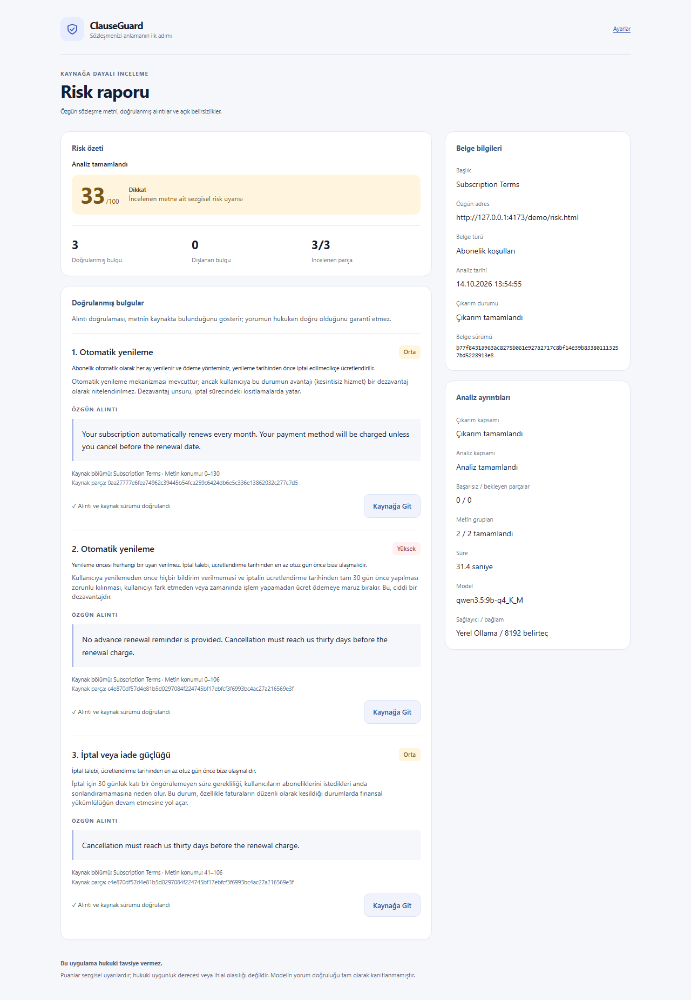
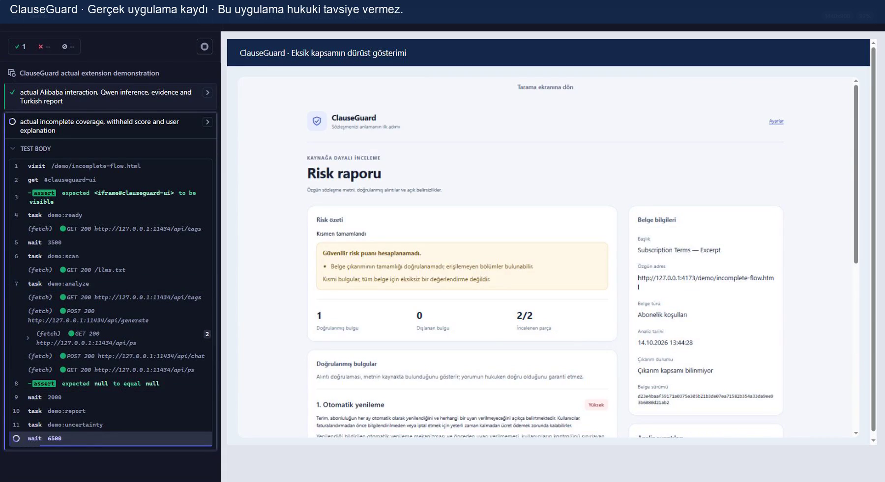
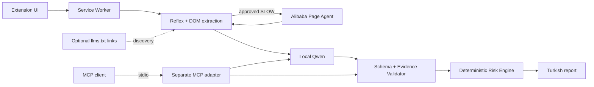

# ClauseGuard

Chrome MV3 sözleşme inceleme uzantısı — üniversite **Software Implementation and Testing** projesi. TypeScript, WXT, React ve Tailwind; gerçek Alibaba Page Agent; deterministik Jev-style Reflex Engine; yerel Qwen; kaynak alıntısı doğrulaması ve Türkçe rapor.

**Bu uygulama hukuki tavsiye vermez.** Puanlar sezgisel uyarılardır, hukuki uygunluk veya ihlal olasılığı değildir. Yerel model sınırlamaları ve insan tarafından doğrulanmamış değerlendirme etiketleri açıkça belgelenmiştir.

## Teslim dosyaları

- [Gerçek gösterim videosu — 80 saniye](demo/clauseguard-demo.mp4)
- [Final doğrulama](docs/final-verification.md)
- [Beş gerçek sözleşme değerlendirmesi](docs/final-evaluation.md)
- [Güvenlik testleri ve sınırlamalar](docs/final-security.md)
- [Mimari ve güven sınırları](docs/final-architecture.md)
- [Etiket inceleme paketi](docs/gold-label-review.md)

Ham Cypress videosu `demo/raw/demo.cy.mjs.mp4` altında korunur; Git'e dahil edilmez. Final MP4 gerçek kayıttan otomatik FFmpeg işlemiyle üretilmiştir. Başarısız denemeler ayrıca arşivlenmiştir. Model yanıtları, puanlar ve ajan etkileşimi taklit edilmemiştir.

## Gerçek uygulama görüntüleri





## Gereksinimler ve kurulum

Test edilen sistem: Windows 10, Node 22.16.0 / npm, NVIDIA RTX 4060 Laptop 8 GB, yaklaşık 32 GB RAM, Ollama 0.40.0, Chromium 153 ve Cypress 15.7.0. Proje Node >=22.12 ister. Chrome uzantısı için masaüstü Chrome; otomatik uzantı testleri için Chromium veya Chrome for Testing gerekir.

```powershell
npm ci
npm run typecheck
npm test
npm run build
```

Model veya runtime kuruluysa yeniden indirmeyin. [Ollama Windows yönergeleri](https://docs.ollama.com/windows) üzerinden NVIDIA destekli runtime kurulabilir; bu teslimde çalışan 0.40.0 değiştirilmedi.

```powershell
ollama --version
ollama list
# Yalnızca tam model eksikse:
ollama pull qwen3.5:9b-q4_K_M
```

İzin verilen model yalnızca `qwen3.5:9b-q4_K_M`'dir. Bulut LLM, farklı quantization veya ek model yoktur. Sunucu `127.0.0.1:11434` üzerinde kalmalıdır; `0.0.0.0` veya wildcard CORS kullanmayın.

```powershell
npm run ollama:start
# İsteğe bağlı özel mevcut model deposu:
# $env:CLAUSEGUARD_MODELS='D:\ExistingOllamaModels'
```

Başlatıcı mevcut loopback sunucusunu yeniden başlatmaz. Projede taşınabilir `.local/ollama/ollama.exe` varsa kullanır, yoksa PATH'teki Ollama'yı bulur. Önceden var olan geliştirme model deposu yalnızca isteğe bağlı geri dönüş yoludur; başka bilgisayarda `Challenge2` gerekli değildir. `-Restart` yalnızca sahipliği doğrulanmış proje runtime'ı içindir.

## GPU doğrulaması

8192 bağlam, flash attention, q8_0 KV cache ve bir yüklenmiş model/sequence korunur. Gerçek üretim sırasında bağımsız ölçüm yapın:

```powershell
nvidia-smi
ollama ps
# Bu çalışma alanındaki taşınabilir runtime için:
.local\ollama\ollama.exe ps
```

`100% GPU` model yerleşimi, NVIDIA VRAM/hesaplama örnekleriyle birlikte doğrulanmalıdır; metin üretmesi tek başına kanıt değildir. CPU/mixed yerleşim analiz sağlayıcısında reddedilir. P4.1 pilotunda 137 yüklü örnek, tam GPU yerleşimi, 7233 MiB tepe VRAM ve yaklaşık 40,385 token/s kaydedildi. 8 GB VRAM'in her bağlamda tam yerleşim garantisi olduğu iddia edilmez.

## Chrome'a yükleme ve kullanım

1. `npm run build` çalıştırın.
2. `chrome://extensions` sayfasında Geliştirici Modu'nu açın.
3. Paketlenmemiş öğe yükle ile `.output/chrome-mv3` klasörünü seçin.
4. İsterseniz geliştirme için `npm run dev` kullanın.
5. HTTP(S) sözleşme sayfasında uzantıyı açıp **Belgeyi Tara** seçin.
6. Tek ve güncel belge bulunduğunda **Risk Analizi Yap** seçin.
7. **Ayrıntılı Raporu Aç** ile alıntıları, kapsamı ve belirsizlikleri inceleyin; **Kaynağa Git** gerçek kaynak dilimini vurgular.

Tarama/analiz yalnızca kullanıcı isteğiyle başlar. Görünür metin FAST yolunda model çağırmadan çıkarılır. Açılması gereken, açıkça izinli kontrol varsa SLOW gerçek Alibaba Page Agent kullanır. Arbitrary website clicking, form gönderme, satın alma, giriş ve script çalıştırma desteklenmez. Tarayıcı verileri yerel oturumda tutulur; iptal ve temizleme denetimleri mevcuttur.

Kapsam veya yorum belirsizse güvenilir tam-belge puanı verilmez. Manuel gerçek Chrome araç çubuğu kontrolü otomatik Chromium testlerinden ayrı, bekleyen bir doğrulamadır.

## Kontrollü belgeler ve smoke testi

```powershell
npm run fixture
# http://127.0.0.1:4173/demo/risk.html
# http://127.0.0.1:4173/demo/negative.html
# http://127.0.0.1:4173/demo/expandable.html
# http://127.0.0.1:4173/demo/incomplete.html
# Değişmemiş saldırı örneği: /p2/injection.html
```

Ayrı terminalde veya fixture sunucusunu durdurduktan sonra:

```powershell
npm run test:smoke
```

Smoke kendi loopback fixture sunucusunu başlatır, WXT build yapar; FAST sıfır-çıkarımı, gerçek Alibaba tıklamasını, gerçek Qwen yanıtını, JSON şemasını, özgün alıntıyı, deterministik puanı, eksik kapsamı, kaynak vurgusunu ve hukuki uyarıyı denetler. Beş büyük sözleşmeyi çalıştırmaz. Sonuçlar `docs/evidence/final/smoke/` içindedir.

Chromium yolu `CLAUSEGUARD_CHROME` ile verilebilir. Yardımcı mevcut Playwright önbelleğini bulur; gereksiz tarayıcı indirmez. Tarayıcı gerçekten eksikse mevcut `playwright-core` CLI kullanılabilir:

```powershell
node node_modules/playwright-core/cli.js install chromium
```

## llms.txt

[Güncel llms.txt önerisinin](https://llmstxt.org/) root `/llms.txt` durumu uygulanmıştır. Service Worker yetkili aktif origin'den gerçek dosyayı alır; Markdown politika bağlantıları Context Manager'a eklenir. Popup kullanıcısı doğrulanmış bağlantıyı açıp normal DOM taramasıyla devam edebilir. HTTPS veya tam fixture HTTP origin'i; 32 KiB, dört saniye, sıfır redirect, credentials omit; kapsam dışı URL reddi.

Dosya metni kaynak kanıtı veya sistem talimatı değildir. Eksik/bozuk/erişilemeyen dosyada DOM yolu devam eder. Nested-path ve HTTP Link-header varyantları uygulanmamıştır.

```powershell
npm run test:llms
```

Beş gerçek HTTP senaryosu ve gerçek uzantı bağlantı-geçişi kayıtlıdır.

## ClauseGuard MCP

[Resmî MCP TypeScript SDK v2](https://ts.sdk.modelcontextprotocol.io/v2/) ile bağımsız **stdio** sunucusu; sıradan Chrome kullanımı için gerekli değildir. Alibaba'nın ayrı opsiyonel MCP sunucusu değildir ve Page Agent'ı uzaktan yönetmez.

```powershell
npm run mcp:start
npm run mcp:test
```

Araçlar:

- `get_risk_categories`: mevcut kategori açıklamaları ve değişmemiş ağırlıklar.
- `verify_evidence`: açıkça verilen metin/alinti/kimlikler için mevcut validator.
- `analyze_document`: açıkça verilen en fazla 1600 karakterlik metinde gerçek yerel Qwen; kaynak kapsamı UNKNOWN kalır ve tam-belge puanı gizlenir.

MCP istemcisi sunucu sürecini başlatır, initialize yapar, araçları listeler ve gerçek çağrılar yapar. Geçersiz argüman/uydurma alıntı reddi ve gerçek Qwen analizi test edilmiştir. Dosya, arbitrary network, browser veya credential aracı yoktur. MCP Inspector ya da başka bir istemcide komut olarak `node`, argüman olarak proje içindeki `scripts/mcp-start.mjs`, çalışma dizini olarak proje kökü kullanılabilir. Sunucu protokol için stdout, banner için stderr kullanır. Bir host npm üzerinden başlatacaksa npm başlıklarını bastırmak için `npm run --silent mcp:start` kullanmalıdır.

## Puanlama, kanıt ve değerlendirme

Her kategoride en yüksek bulgu şiddeti alınır. LOW/MEDIUM/HIGH çarpanları 0,4/0,7/1,0; kategori ağırlıkları 20/15/14/17/20/18/14/12. Toplam son aşamada yuvarlanır, 100 ile sınırlanır. Model doğrudan puan üretemez. Aynı kategori tekrarları puanı toplama yoluyla şişirmez.

Birebir kaynak konumu, hash ve özgün alıntı doğrulanır. Yalnızca bire bir NBSP eşdeğerliği kabul edilir; fuzzy alıntı tamiri yapılmaz. Kaynak doğruluğu, yorumun hukuki doğruluğunu kanıtlamaz.

GitHub, Discord, Reddit, Spotify TR ve Dropbox'ın authentic kayıtları yeniden kullanılmıştır. **P4 tam çıkarılmış-metinde:** TP4/FP6/FN4, precision %40, recall %50, F1 %44,4. **P4.1 seçili-grup pilotunda:** TP4/FP4/FN4, tüm oranlar %50. Kapsamlar farklıdır; sonuçlar birleştirilmez. Etiketler PROVISIONAL ve insan doğrulaması 0'dır. Tam model trafiği/telifli kaynaklar `.local/` altında tutulur ve yayın arşivine girmez. Yeni bilgisayarda ham yeniden işleme için kaynakların yeniden yetkili alınması gerekir; kayıtlı rapor/metrikler teslim edilir.

## Güvenlik ve sınırlamalar

```powershell
npm test
npm run test:security:p4
```

Orijinal 12 saldırı senaryosu korunur. P4.1'in sonraki tekrarında tamamlanan 9 vaka, kalan 3 vakayı geçmiş saymaz. Runtime güvenliği ile gerçek riskin tespiti ayrıdır. Model bazen istisnaları kaçırır, kategorileri karıştırır, gereksiz belirsizlik veya tekrar üretir. Üç geniş anlamsal test hatası hâlâ belgelenmiştir. Altı geliştirme bağımlılığı advisory'si kayıtlıdır; depo vulnerability-free olarak sunulmaz.

## Gerçek Cypress gösterimi

```powershell
npm run build
npm run demo:record
npm run demo:edit
npm run demo:verify
# Kayıt, düzenleme ve doğrulama birlikte (önce build):
npm run demo:all
```

`video: true` yerel run modunda kullanılır; ücretli Cypress Cloud veya cloud LLM yoktur. Kayıt iki kısa belge kullanır. Gerçek paketlenmiş `/demo.html`, aynı App/ReportPage ve Service Worker'ı localhost gösterim sayfasında sunar. Cypress'in iframe ortamı yalnızca iki sabit fixture belgesine bağlanır; model ve ajan işlevleri taklit edilmez. Test kodu sadece uzantı UI düğmelerini etkinleştirir; kaynak politika düğmesini gerçek Alibaba tool'u tıklar.

Ham kayıt `demo/raw/demo.cy.mjs.mp4`; final `demo/clauseguard-demo.mp4`. FFmpeg mevcut Cypress önbelleğinden veya PATH/`FFMPEG_PATH` üzerinden tekrar kullanılır. FFprobe kurulu paket veya `FFPROBE_PATH` ile bulunur. Script süreyi <=90 saniye, MP4/video stream, çözünürlük ve tam decode ile doğrular; temsilî kareleri çıkarır. Yeni kayıt sonrası okunabilirlik tekrar görsel incelenmelidir. Son teslimde 80 saniye / 1800×982 / H.264 ve görsel inceleme PASS kayıtlıdır.

Cypress child sürecinde `ELECTRON_RUN_AS_NODE` kaldırılır; Windows ayarı değiştirilmez. Fixture sunucusu 4173 portunu kullandığından kayıt/test öncesi ayrı `npm run fixture` sürecini kapatın.

## Mimari



Güven sınırları ve sunum farkı [final-architecture.md](docs/final-architecture.md) içinde açıklanmıştır. Önceki P0–P4.1 raporları ve başarısız kanıtlar korunur. `npm run delivery:package`, kaynak ve uzantı ZIP'lerini `delivery/` içinde üretir; **GitHub'a push yapılmamıştır**. Manuel Chrome araç çubuğu doğrulaması ve gerçek insan etiket incelemesi bekler.
