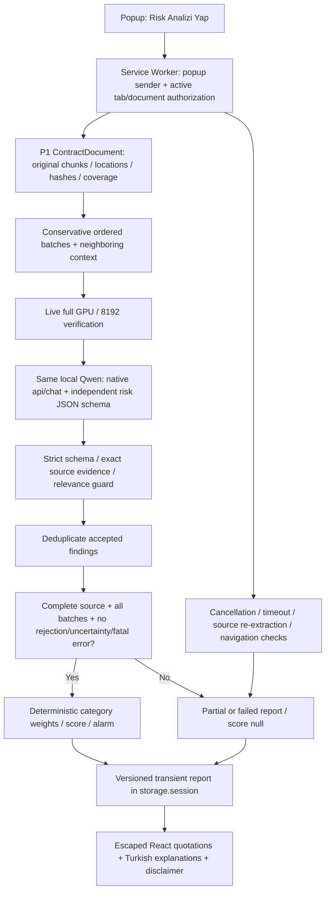
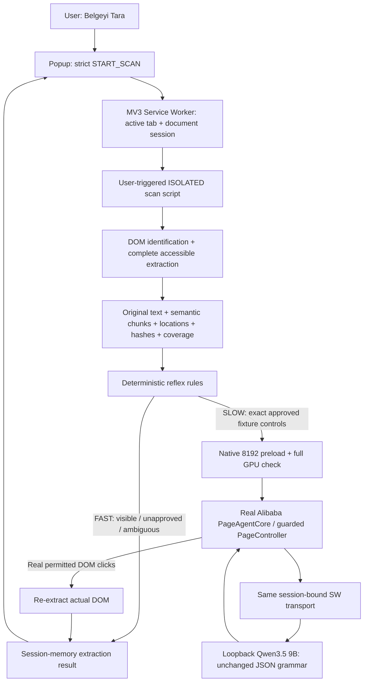
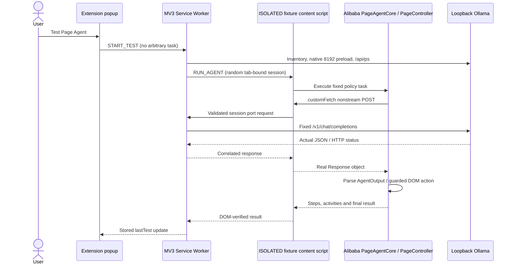

# ClauseGuard architecture — P3

## P3 UI and session layer

Three packaged React pages share Turkish presentation components and local Tailwind CSS: popup workflow, detailed report, settings. `ui-session.ts` adds bounded tab/document/job metadata to the existing transient P1/P2 records. `ui-protocol.ts` validates exact packaged page identities and limits report/settings commands while preserving popup-only analysis and navigation initiation. Current-tab filtering prevents cross-site result adoption; source navigation re-extracts and verifies the original document and exact text-node Range before temporary highlighting. Risk scores remain engine outputs. No AI schema, category, score, provider/configuration or Page Agent grammar change was made.

See [UI architecture](ui-architecture.md), [user workflow](user-workflow.md) and [P3 verification](p3-verification.md) for storage/lifecycle, activeTab, source integrity, actual tests and manual Chrome limitations. The prior phase architectures below are historical and preserved.

## P2 addition

The popup's strict START_ANALYSIS command consumes the Service Worker's own P1 result and original tab/document binding. It cannot supply source text, a URL, model configuration or arbitrary request. `src/risk/` contains the central category registry, independent Zod/native output schema, context budgeting, serial provider/orchestrator, exact evidence verification, deduplication and deterministic scoring. `src/extension/analysis-state.ts` validates transient job checkpoints and interruption recovery.

Risk requests use only the fixed loopback native endpoint, no Page Agent tools or API secrets. Existing Page Agent sessions continue using their unchanged navigation grammar and Service Worker transport. Source document integrity is recomputed before analysis; document identity/hash are rechecked between asynchronous steps. Source changes and actual worker restart invalidate score eligibility. One in-flight operation prevents competing scans/analysis; no parallel model loading. Source/report state stays in browser session memory. See [risk-analysis.md](risk-analysis.md), [evidence-validation.md](evidence-validation.md), [scoring.md](scoring.md) and [p2-verification.md](p2-verification.md) for implemented behavior, executed evidence and limitations.

## P1 addition

The existing transport, official Alibaba packages and P0.1 grammar are retained. `src/extraction/` implements Chrome-independent DOM/source schemas, identification, ordering, semantic chunking, locations and hashes. `src/reflex/engine.ts` validates deterministic transitions. `src/agent/discovery-agent.ts` reuses the same provider adaptation/registry restrictions for a controlled multi-button navigation task. The original P0 fixture/controller remains unchanged.

New permission `scripting` is justified by user-initiated top-frame extraction with the existing `activeTab` grant ([Chrome API requirements](https://developer.chrome.com/docs/extensions/reference/api/scripting)). The scan script has empty registration matches and is injected explicitly; the built manifest retains only the two existing loopback host permissions. There is no MAIN bridge, general request proxy or all-sites host grant. Scan messages are strict and extension-only; model sessions authorize only exact extension-owned fixture URLs with declared controls. Every async scan command targets the injected Chrome document identity, preventing same-URL reload reuse.

FAST does not touch model preparation or session transport. SLOW sends a navigation-only control view to the model, not contract contents, and retains the P0.1 official JSON normalization path ([Alibaba model configuration](https://alibaba.github.io/page-agent/docs/features/models/)). Source results live in `storage.session`, not persistent local storage. General pages are read-only with unknown/partial coverage. Real loopback Chromium integration is verified; real toolbar-granted arbitrary-origin injection remains unverified. Full extraction/state semantics and limitations are in [document-extraction.md](document-extraction.md) and [reflex-engine.md](reflex-engine.md).

## Preserved P0/P0.1 architecture

P0.1 retains this architecture. `src/llm/macro-schema.ts` now derives a stricter
Ollama JSON output grammar from the actual Alibaba macro, requiring its existing
reflection fields plus action. The tool/action definitions themselves stay
unchanged, and the official normalizer/Zod/runtime guards remain authoritative.
The Service Worker validates the exact derived grammar. No new page bridge,
streaming mode, executable parser or operation was added. See
[the measured reliability investigation](page-agent-reliability.md).

## Implemented boundary

This scaffold establishes local model access, NVIDIA measurements and one explicitly permitted agent task. Future risk scoring is not implemented. The code is strict TypeScript, WXT / React and Chrome Manifest V3; Vitest covers failure boundaries. `scripts/` contains native Windows diagnostics and an independent real-browser harness.

## Modules

| Location | Responsibility |
| --- | --- |
| `entrypoints/background.ts` | Popup-only initiation, one active task, short-lived sessions, fixed local transport, live GPU/context precheck, result storage |
| `entrypoints/content.ts` | Exact fixture guard; receives Service Worker commands in the ISOLATED world |
| `entrypoints/popup/`, `src/ui/` | Current URL, local inventory status, historical host GPU report, start button, last result |
| `src/core/` | Literal model/provider/context/fixture configuration and strict result schemas |
| `src/extension/` | Sender/session schemas and nonstream fetch transport over `runtime.Port` |
| `src/llm/` | Loopback health/load/residency checks and Ollama request adaptation |
| `src/agent/` | Actual Alibaba core/controller construction, real registry restrictions, element identity/index guard, event capture and DOM completion assertions |
| `fixtures/` | Fictional short legal terms and an initially hidden privacy section |
| `tests/unit/` | Mocked boundaries and actual library parsing/registration tests |
| `scripts/test-browser.mjs` | Real extension + model + DOM + isolation tests, fresh cached-browser profile |
| `scripts/gpu-diagnostics.mjs` | Real native inference, repeated nvidia-smi / ollama ps / API residency sampling |

## Actual Alibaba integration

The inspected published `@page-agent/core`, `@page-agent/page-controller` and `@page-agent/llms` exports are version 1.12.4. `PageAgentCore` executes the fixed task; a `FixtureController extends PageController` performs the actual model-selected click through `super.clickElement(index)`. There is no simulated agent or application-side manual policy click.

Core worked in a genuine WXT ISOLATED content script. DOM APIs, extraction, native library events and actual clicks all worked there. A MAIN-world bridge is unnecessary and absent. The page cannot read core instances, invoke privileged extension APIs, or access the custom fetch bridge. See real browser security evidence.

The actual model schema is a single `AgentOutput` macro tool with a union of allowed DOM actions. The library validates arguments through Zod and performs upstream response normalization; its normalizer sometimes recovers JSON emitted in message content. Raw responses are retained so this is distinguishable from native `tool_calls`. We do not synthesize missing actions or force a click when inference fails.

Installed LLM code calls `response.json()` and is not an SSE client. Both sides explicitly require `stream:false`; the bridge preserves the actual response body and HTTP status, correlates requests and propagates aborts. Unsupported streaming is rejected. Alibaba's automatic Qwen/DashScope `enable_thinking` field is removed through its supported `transformRequestBody`, then documented Ollama `reasoning_effort:'none'` is set. Sampler: temperature 0.2, presence penalty 0, max_tokens 1536. MaxRetries 2, maxSteps 6, task stop timer 150 seconds. Supported additional instructions require the action field; they do not replace the real schema.

## Context and residency

Native diagnostic requests set `options.num_ctx` individually. The OpenAI-compatible API does not accept that native option in this integration. The server starts with `OLLAMA_CONTEXT_LENGTH=8192`; before each task the Service Worker preloads with native `num_ctx=8192` and confirms actual `/api/ps` context 8192 and `size_vram >= size > 0`. The browser tests independently capture that residency after tasks. No alias, model replacement or re-download is needed.

The model remains Q4_K_M. Flash Attention and a `q8_0` KV cache made the measured 8192 configuration fully GPU resident; larger context is tested separately and reported honestly. Historic GPU diagnostics are copied into the packaged popup report. That timestamped report is not continuously refreshed or a browser GPU API.

DOM content over 12,000 characters and oversized serialized requests are refused rather than silently shortened. Recorded successful step token usage is below 8192; completions reaching context capacity are rejected. Benchmark prompts contain beginning/end markers and native runner logs are inspected for truncation and OOM. The 512-token diagnostic output cap is deliberate and distinct from input truncation.

## Security and operation policy

- Only exact extension-popup senders initiate STATUS / START_TEST. No arbitrary task/URL message exists.
- A random UUID session is bound to the active approved fixture tab, frame 0, document identity, origin and 180-second lifetime. Maximum 14 model requests; concurrent requests are rejected. Session access is over an extension runtime port, not page postMessage.
- Transport has a fixed exact model and fixed loopback chat endpoint, strict body fields, bounded sizes, no redirects and finite abort timers. Other providers, endpoints, streaming and unsafe schemas are rejected.
- Supported `customTools` disables all unwanted tools; actual registry iteration removes any unknown future tool. Only `done`, `click_element_by_index`, and bounded document `scroll` remain. Experimental script execution and llms.txt are disabled.
- Alibaba's interactive whitelist is additive, so all other elements are explicitly blacklisted. A fresh extraction index and the original approved button's connected identity, id, type, marker, non-form placement, disabled state and exact URL are checked before the real click. Removed/replaced buttons trigger a cooperative supported agent stop.
- The fixture contains no real personal data or forms. Fault injection removes the target during actual inference and verifies blocked execution, task stop, hidden policy and no unrelated clicks.
- Loopback listener only, cloud disabled, exact trusted extension CORS origin only. The placeholder `ollama` is harmless; no real secret or future cloud credential is stored or sent to the page.
- Manifest grants `activeTab`, `storage`, exact Ollama and fixture host permissions. Chrome match patterns cannot constrain port, so the content script initially matches loopback HTTP then returns unless the full exact fixture URL matches. No externally_connectable or web-accessible bridge.
- Only the last fictional fixture result is stored. Production/page-content retention is not implemented. Raw fixture prompts and responses appear in opt-in development evidence, never automatically collected from arbitrary pages.

WXT reports upstream unused `eval` code in the PageController bundle. It is documented rather than hidden: the script tool is disabled and removed, no registered action reaches it, and extension CSP contains no `unsafe-eval`. P0 has not audited every upstream line or made claims about safety on adversarial arbitrary sites.

Official references: [Alibaba repository](https://github.com/alibaba/page-agent), [model configuration](https://alibaba.github.io/page-agent/docs/features/models/), [Ollama OpenAI compatibility](https://docs.ollama.com/api/openai-compatibility), [context settings](https://docs.ollama.com/context-length), and [FAQ / memory cache settings](https://docs.ollama.com/faq).
