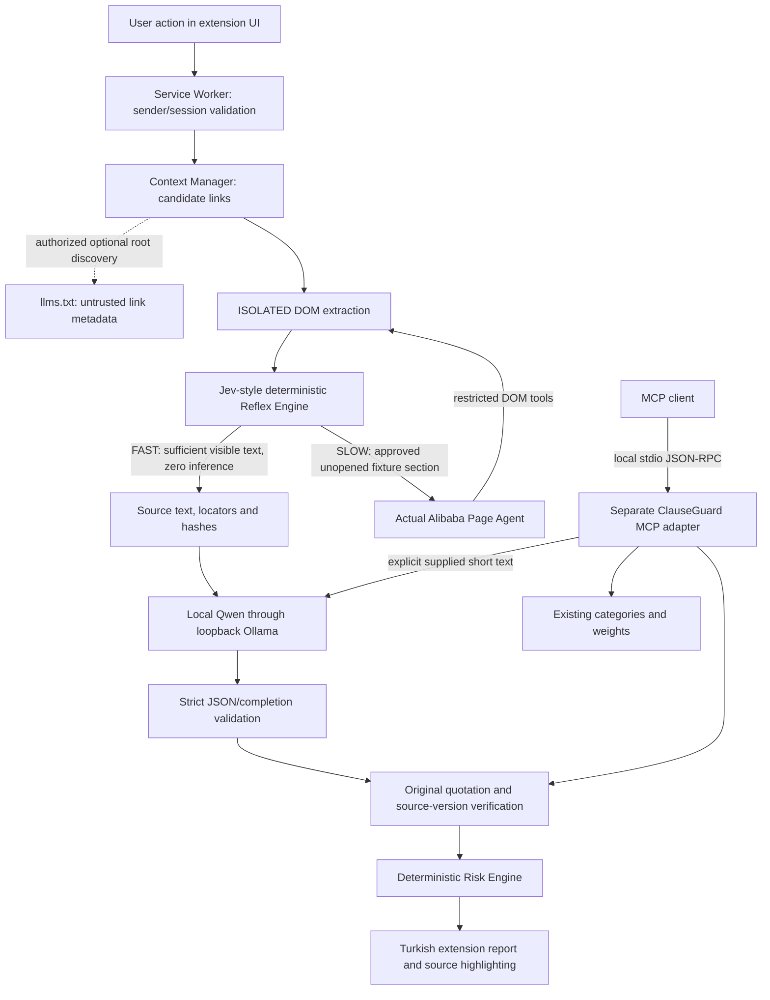

# Final architecture and trust boundaries

ClauseGuard is a university implementation/testing project, not a legal compliance oracle. The actual Chrome MV3 extension uses WXT, React, TypeScript and Tailwind; its Node MCP adapter is independent.

## Browser flow

The Service Worker owns user-initiated operations, model networking and immutable tab/document bindings. DOM inspection/extraction runs in an ISOLATED content script. FAST routing is deterministic and never asks a model whether extraction is adequate. SLOW invokes the real `@page-agent/core` and `@page-agent/page-controller` only for explicitly registered safe fixture controls, then re-extracts the actual changed DOM. Arbitrary website clicking remains unsupported.

`llms.txt` discovery follows the root-file case of the [current proposal](https://llmstxt.org/). HTTPS active-origin or the exact local fixture HTTP origin is allowed, with no credentials, zero redirects, four-second timeout and 32 KiB streamed-body limit. Markdown policy links are parsed into Context Manager candidates. Missing/invalid/unavailable files leave ordinary DOM discovery working. Only an extension UI user action can follow a validated same-origin candidate; its text is never contractual evidence or a system instruction. Nested-path/HTTP Link-header discovery is not implemented.

Extracted original text, DOM locators, literal spans and hashes are the evidence source. The existing local Qwen model returns strict structured proposals without risk tools or scores. The validator rejects truncated responses, unsupported fields, tool calls, wrong versions and fabricated quotes. Only one-to-one NBSP/narrow-NBSP space equivalence is allowed; original source text is restored. Scoring uses the highest severity within each unchanged category, integer-tenths arithmetic, final rounding and a 100 cap. Incomplete extraction/analysis, rejected evidence or unresolved meaning withhold a complete-document score.

## MCP adapter

The [official MCP TypeScript SDK v2](https://ts.sdk.modelcontextprotocol.io/v2/) serves `get_risk_categories`, `verify_evidence` and `analyze_document` over stdio. The real SDK client initializes, lists tools, invokes them and checks structured results. Inputs are schema-validated; there are no browser, arbitrary file, arbitrary URL or credentials tools. Supplied text is inserted as text into an inert JSDOM document and processed with the existing extractor/validator/analyzer. Its coverage remains UNKNOWN and a complete-contract score is withheld.

This is ClauseGuard's own adapter, not Alibaba's optional MCP server. It does not remotely operate Page Agent and is not required for ordinary extension use or a mandatory stage after every model response.

## Cypress presentation route

Direct Cypress `cy.visit(chrome-extension://...)` was experimentally rejected as an HTTP-relative URL. The localhost demonstration embeds `/demo.html`, an actual packaged extension page using the same `App`, `ReportPage` and Service Worker. No imitation UI or mocked Chrome/LLM backend is used.

Cypress's AUT itself is an iframe. A restricted adapter binds operations to exactly one of two known localhost demonstration documents, with frame/document identity checks. Normal toolbar operations retain frame-zero binding. The extension page is web-accessible only from the fixture origin; page JavaScript receives no arbitrary privileged proxy or credential channel. Node test tasks activate real extension UI buttons; only actual Alibaba tools click the source policy button. Report-layout changes are presentation-only. Manual branded Chrome toolbar verification remains a separate outstanding check.

## Remaining limits

Controlled real-model fixtures demonstrate functionality, not universal semantic correctness or prompt-injection immunity. Reference labels remain unverified by humans, real-source coverage is incomplete, and model explanations can omit exceptions or produce false uncertainty. Browser session data stays local and can be cleared; copyrighted full source snapshots/model traces are excluded from publication. Bu uygulama hukuki tavsiye vermez.
