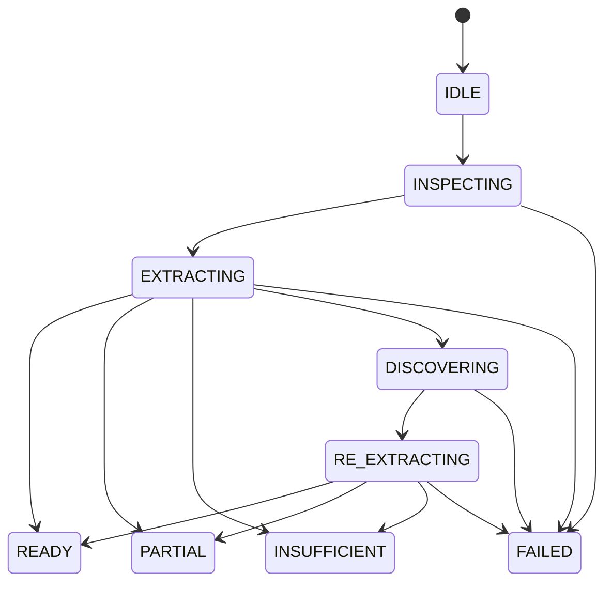

# P1 deterministic reflex engine

The engine is a small TypeScript state machine inspired by reflex routing. It does not install Jev, llms.txt, MCP or another agent framework. DOM inspection and explicit rules decide FAST/SLOW; no model classifies the route or evaluates risks.

FAST performs one full extraction. Useful visible legal text reaches `READY` with its independent extraction status (`UNKNOWN` can be operationally ready). Ambiguity or known omissions produce `PARTIAL`; no useful legal text produces `INSUFFICIENT`. FAST never prepares a model or opens an LLM session. Popup STATUS may separately inventory the local model; browser evidence counts inference POSTs during the actual scan and proves zero.

SLOW is attempted only when a non-ambiguous document is insufficient or has unopened sections **and** an exact trusted fixture URL has extension-owned approved controls. The Service Worker checks the unchanged model's full GPU residency and 8192 context before granting a short-lived session. Actual Alibaba PageAgentCore chooses real DOM indices and executes upstream PageController clicks. After discovery the engine extracts the actual resulting DOM; it never accepts a rendered model answer as evidence of completion. Failed discovery cannot yield `READY`, even if text became visible. A removed control or stale page produces `FAILED` with its actual trace when available.

General sites use read-only FAST extraction. Unapproved hidden sections stay partial/insufficient with warnings: a page attribute cannot authorize a click or model connection. No cross-page navigation, new origin or unrelated tab operation exists.

Bounds: one inspection, at most two extractions, at most one discovery. Existing Page Agent limits remain six steps/two retries/150 seconds, restricted click/scroll/done registry, no script execution and no llms.txt. Reflex deadline is 175 seconds and the transport session lasts 180 seconds with 14 validated requests. Cancellation is explicit through the popup, propagates to the agent and fetch aborts. URL checks surround asynchronous stages; Chrome document identity targets prevent same-URL reloads from receiving stale commands. Terminal states cannot restart discovery. Unit tests exercise invalid transitions, timeouts, cancellation, stale pages and failed discovery; real browser tests separately inject removal, cancellation and navigation during genuine inference.

The navigation prompt contains only approved controls with actual library-generated indices and independently read OPEN/COLLAPSED state. This is a deliberate purpose-specific view, not truncated contract extraction. The full contract and unrelated page text stay outside Ollama. The P0.1 response grammar, official normalizer, fixed provider/model and native 8192 preload are unchanged. Native tool_calls are still unreliable; schema-constrained content JSON remains the verified route.
