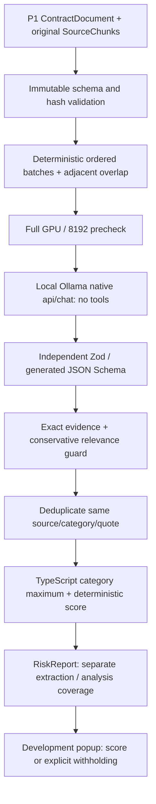

# P2 source-backed local risk analysis

P2 adds potential-disadvantage analysis, not legal noncompliance certification. The model proposes findings and severity; TypeScript validates evidence and computes every numeric score. The debug popup always states **Bu uygulama hukuki tavsiye vermez.** It renders text through React, never HTML from the model. No polished dashboard, MCP, llms.txt, five-site evaluation, Cypress video or publication is implemented.

## Schema and provider

`src/risk/schema.ts` is the single schema source. `z.toJSONSchema(..., {target:'draft-7'})` generates native Ollama's `format` object. Eight category IDs and LOW/MEDIUM/HIGH are enums. At most eight findings per response; nonempty bounded chunk IDs, original quotes (8–1400 characters), Turkish explanation/reason (12–600) and strict objects with no extras. No riskScore is requested or accepted. Schema enforces structure/length, not semantic correctness or a perfect Turkish-language classifier.

Unresolved issues are strict `{sourceChunkId, issueTr}` objects, at most eight, with a 16–400-character Turkish issue statement. This deliberate extension to the initial suggested schema prevents the observed loose-ID/serialized-fragment output from string arrays and anchors uncertainty to available batch sources. The final report exposes their text separately from verified findings. Unknown uncertainty references cause withholding, not invented source evidence.

The endpoint is exactly `http://127.0.0.1:11434/api/chat`, distinct from Page Agent's `/v1/chat/completions`. Requests use the exact existing model, `stream:false`, `think:false`, `temperature:0`, `num_ctx:8192`, `num_predict:1536`, and keep-alive ten minutes. There are no tools, Page Agent actions or credentials. The existing P0.1 tool grammar and official normalizer are unchanged. Before and after each risk request, `/api/ps` must independently show full GPU residency at 8192; CPU/mixed/unknown residency fails closed.

The initial real probe verified native JSON Schema support on the installed **Ollama 0.40.0**, rather than inferring support from newer docs. See [probe](evidence/p2-probe/probe.json). Official interfaces: [native chat](https://docs.ollama.com/api/chat), [structured output and Zod conversion](https://docs.ollama.com/capabilities/structured-outputs). Actual runtime tests and revised schemas are distinguished in the P2 verification report.

## Context budgeting

The estimate counts UTF-8 bytes for system instructions, serialized source data and JSON Schema, plus 256 template tokens. One byte is conservatively budgeted as one token; schema grammar is included as overhead even when it is not rendered in the prompt. This is an estimate, never an exact tokenizer measurement. Reserve 1536 completion tokens from 8192. Exact returned prompt/evaluation counts are recorded; unexpected estimate overruns, context-capacity/output-cap reaches, unfinished responses and non-stop completion are rejected.

Batches preserve source order, IDs, original text and heading paths. New semantic headings prefer batch boundaries. Capacity splits retain one adjacent prior chunk as overlap when it fits. Overlap does not change primary ownership: each chunk has one required analysis batch. Indivisible over-budget chunks remain explicit failed coverage without truncation. If split-clause context cannot fit together, context warnings withhold a final score. A long document is not sent in one request. This conservative policy trades many small requests for predictable memory usage.

## Orchestration and lifetime

`analyzeDocument` validates an immutable document snapshot and source hashes, prepares batches, calls the injected local provider serially, validates responses again, verifies evidence, deduplicates, records coverage and derives the report. One retry is allowed only for invalid structured responses. Provider/GPU failures, cancellation and stale sources stop processing; a failed structured batch can coexist with later successful batches, but cannot disappear from coverage.

Every batch records IDs, estimated budget, status, attempts, errors and actual timing. Analyzed/failed/pending chunks are separate. Extraction COMPLETE is not inferred from model completion. A final score requires verified COMPLETE extraction, every required batch completed, all chunks analyzed, no rejected findings, no unresolved issues and no fatal interruption. UNKNOWN/PARTIAL source keeps valid findings and always yields `score:null`. Complete safe fixtures may score zero.

The Service Worker accepts START_ANALYSIS only from the packaged popup, consumes its own session-stored single extracted document, and verifies the current active tab matches the original scan binding. The page cannot supply a document, endpoint, model or instructions. Read-only re-extraction targets the original Chrome document ID and compares hashes before/after requests. Navigation, same-URL reloads and changed text invalidate the job. Analysis does not send risk commands to Page Agent or grant model DOM tools.

Cancellation aborts provider/preparation requests. Per-request deadline is 90 seconds; orchestration deadline is 15 minutes. Only one extension operation is active, with the existing single-loaded-model server configuration. Browser-session checkpoints do not survive as an eligible score after worker interruption: startup marks an old RUNNING job INTERRUPTED and pending coverage cancelled/failed. Restart requires explicit user action. Interrupted duration is the last saved checkpoint, not a fabricated final duration.

## Interpretation limits

Exact quotation validation proves textual existence only. Negation, exceptions, consent, refunds and adjacent clauses are included in prompts and tested with independently authored labels. A narrow retention relevance guard rejects storage claims when the cited source chunk contains no explicit storage/data context; it does not classify risks or establish legal meaning. It can conservatively reject unusual vocabulary, and cannot detect every misleading interpretation or contradictory qualification.

Model tests have exposed unsupported retention interpretations despite valid JSON and exact quotes. Those runs are preserved; the model cannot be treated as a reliable legal authority. Prompt injection has no tool/control-plane access and cannot bypass schema/hash/evidence checks, but can still affect semantic proposals or uncertainty. Absence, ambiguous meaning and processing failures remain separate from verified risk evidence. See [evidence-validation.md](evidence-validation.md), [scoring.md](scoring.md), and the actual [P2 results](p2-verification.md).
