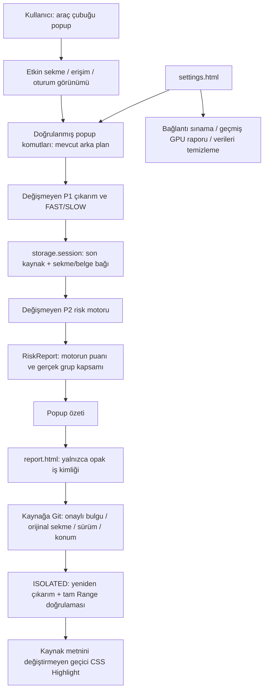

# P3 arayüz mimarisi

React, TypeScript ve yerel derlenen Tailwind CSS 4.3.3 kullanılır. CSS için yalnızca `tailwindcss` ve `@tailwindcss/vite` geliştirici bağımlılıkları eklendi; CDN, görsel kitaplığı, bulut veya yeni arka uç yok. [Resmî Vite kurulumu](https://tailwindcss.com/docs/installation/using-vite) mevcut WXT Vite yapılandırmasına uygulanır.

## Görünümler ve veri

- `App.tsx`: 390 piksel popup; etkin sayfa, salt okunur erişim, kurulu model bağlantısı, iki aşamalı kullanıcı akışı, gerçek metin grubu sayısı, iptal ve son oturum özeti.
- `ReportPage.tsx`: tam sayfa/telefon boyutlarına uyarlanan rapor; belge başlığı/adresi/türü/tarihi/sürümü, motordan gelen puan/alarm, kesin alıntı, Türkçe açıklama, kaynak başlığı/konumu, reddedilen bulgu sayısı, başarısız/bekleyen parçalar ve belirsizlikler.
- `SettingsPage.tsx`: sabit yerel sağlayıcı/model/8192 yapılandırması, envanter bağlantısı, geçmiş GPU ölçümünün tarihi, gerçek tanılama komutları, onaylı temizleme. Modeli veya sunucu ayarlarını değiştirmez.
- `presentation.ts`: Türkçe durum, hata, çıkarım, alarm ve önem düzeyi eşlemeleri. Sayısal puanı hesaplamaz. Uygun olmayan veya eski kaynak için `null` gizlenmez ve sıfırla değiştirilmez.
- `components.tsx`: paylaşılan kimlik, kart, gerçek durum yüklenmesi, puan ve zorunlu açıklama. Veriler React metni olarak gösterilir; `dangerouslySetInnerHTML` yok.

`ui-session.ts` ek bir küçük kimlik kaydı tutar: tarama UUID, orijinal sekme, URL, Chrome belge kimliği, başlık, başlangıç zamanı, gerçek aşama, geçersizlik ve analiz UUID. Sözleşme veya RiskReport bu kayda kopyalanmaz. Var olan `lastScan`, `scanBinding`, `lastAnalysis` kullanılır; `storage.session` dışında sözleşme/rapor kalıcılığı eklenmedi. Var olan `lastTest` yerel tanılaması ayarlardan temizlenebilir.

Yeni tarama önceki rapor erişimini kaldırır. Aynı sekme/URL eşleşmeyen popup eski sonucu göstermez. Rapor adresi yalnızca `?id=<UUID>` içerir. Rapor okuma tarama oturumu, analiz iş kimliği, URL, belge kimliği ve içerik özetini eşleştirir. Başka rapor sayfası kimliği veya içerik betiği bir rapor komutunu taklit edemez.

## Yaşam döngüsü ve izinler

Popup kapanınca React dinleyicileri kaldırılır, arka plan işi iptal edilmez. Yeniden açıldığında arka plan durumundan okunur; başlangıç komutları otomatik gönderilmez. İlerleme depolama olaylarından gelir; zamanlayıcıyla sahte yüzde veya denetimsiz arka plan sorgulaması yoktur. Eşzamanlı okumalarda en yeni görünüm uygulanır. Sonuç yayımlanırken etkin işlem kilidi uyumlu şekilde güncellenir.

P2'nin var olan kesinti mekanizması korunur. Arka plan yeniden başladığında eski RUNNING analiz açıkça INTERRUPTED olur; uygun puan korunmaz. Kesilmiş tarama da başarısız olarak sunulur. Otomatik devam veya süresiz Service Worker varsayımı yoktur. Sayfa yüklenmesi, adres değişimi veya kaynak sekmenin kapanması UI kaydını geçersiz kılar; aynı URL'de yeniden yükleme de eski belge kimliğine bağlanamaz.

İzinler hâlâ yalnızca `activeTab`, `storage`, `scripting`; sabit iki loopback host izni. `<all_urls>`, `tabs`, `debugger`, kalıcı genel site izni eklenmedi. `options_ui` yalnızca ayar sayfasının kaydıdır. [Chrome activeTab](https://developer.chrome.com/docs/extensions/develop/concepts/activeTab) açık kullanıcı uzantı eylemiyle geçici erişim sağlar. Popup HTML'ini sıradan sekmede açmak bu izni kendiliğinden vermez.

`ui-protocol.ts` paketlenmiş popup/report/settings yollarını ve komutlarını doğrular. Ayarlar yalnızca STATUS/CLEAR_DATA; rapor yalnızca kendi GET_REPORT/NAVIGATE_SOURCE komutları; mevcut tarama, analiz ve Page Agent başlatma komutları yine yalnızca popup'tandır. Sayfa JavaScript'i, içerik betiği veya rastgele uzantı yolu ayrıcalıklı yetki alamaz. Yeni ağ proxy'si veya sayfa köprüsü yoktur.

## Kaynak yönlendirme

Arka plan kabul edilmiş bulguyu kendi raporundan seçer; UI'dan kaynak metni, locator, tab veya URL kabul etmez. Orijinal sekme/Chrome belge kimliği doğrulanır. ISOLATED betik mevcut DOM'u yeniden çıkarır, belge kimliği/özeti ve kaynak chunk/locator eşleşmesini kontrol eder. CSS selector tek görünür öğe üretmeli; özgün text-node segmentleri ve UTF-16 alıntı ofsetleri tam eşleşmelidir. Bir parçada birden çok alıntı konumu varsa yönlendirme reddedilir.

Güvenli Chrome CSS Custom Highlight, özgün Range'i boyar; metin düğümleri sarılmaz, sözleşme değişmez. Sekme etkinleştirilir ve öğeye kaydırılır. Vurgu sekiz saniye sonra temizlenir; sonraki vurgu öncekinin zamanlayıcısını temizler. Sayfa değişmişse, tab kapanmışsa, konum belirsizse veya Highlight desteklenmiyorsa anlaşılır hata gösterilir; ilgisiz kaynak vurgulanmaz.

Vurgu stilinin hesaplanan rengi ayrıca kontrol edilir; CSP veya sayfa stili boyamayı engellerse başarılı vurgu iddiası yerine desteklenmiyor hatası döner. Aynı anda gelen popup başlangıçları, ilk tab/depo await işleminden önce alınan kilitle ayrılır. Eski tanılama ve tarama sonuçları işlem temizliği sonrasında yayımlanır; popup artık bitmiş bir iş için eski etkin kilidi kullanmaz.

Kapsam/anlamsal sınırlamalar, gerçek tarayıcı kanıtları ve engeller [P3 doğrulamasında](p3-verification.md) kayıtlıdır. P0.1 grameri, resmî Alibaba normalleştiricisi, risk kategorileri/ağırlıkları, kanıt ve AI yapılandırması değiştirilmedi.
